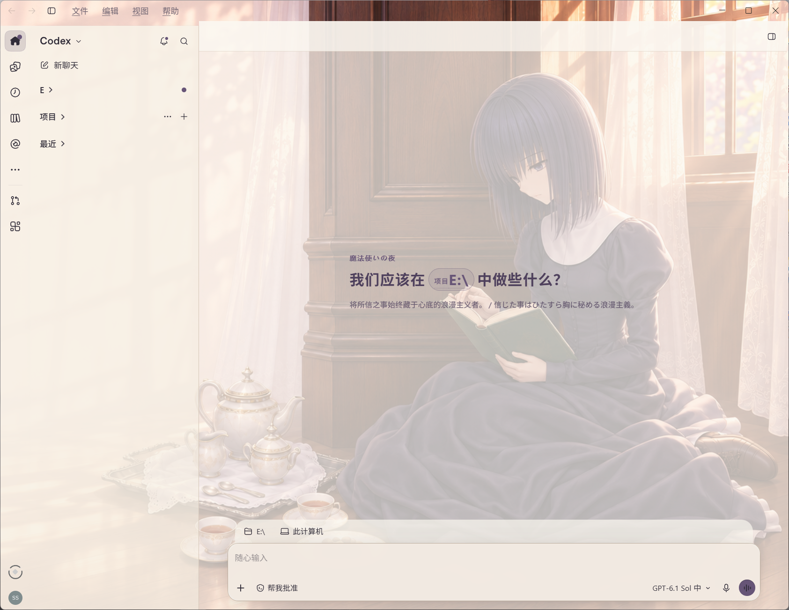
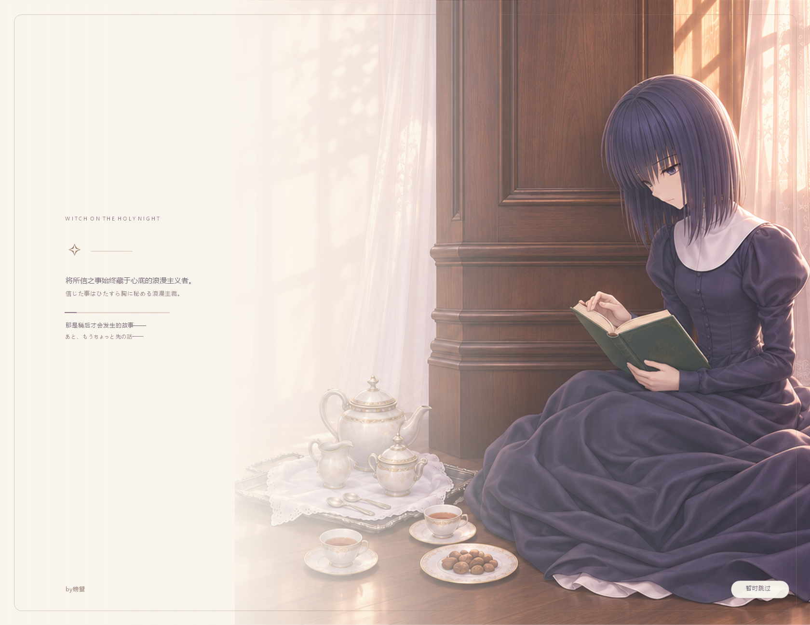

# Silkframe

Persistent image skins for Codex on Windows.

Windows x64 · Preview · MIT · by螃蟹

[简体中文](README.zh-CN.md) · [Download](https://github.com/7892samiuel/silkframe/releases) · [9-second demo](docs/media/demo.mp4)



## What we built

- **Original activation preserved.** Prepare the local theme channel inside the original app process, keeping its native profile and activation arguments.
- **A startup curtain with its own lifetime.** Cover the app's internal window handoff, then reveal the interface after the theme is verified. Skippable, with bounded timeouts.

Provide an image; the skill builds its palette and saves the theme. The loading image, colors, text and credit are configurable. Pause, resume and disable are included.

[Design notes](docs/DESIGN.md)

## Quick start

Download the source ZIP from [Releases](https://github.com/7892samiuel/silkframe/releases), extract it, then run:

```powershell
powershell -NoProfile -ExecutionPolicy Bypass -File .\scripts\Install-Skill.ps1
```

Attach an image in Codex and ask:

```text
Use $codex-image-skin to make this image my skin.
Keep the original app entry and restore it when Codex reopens.
```

The first setup installs a local runtime. If Codex was already open without a prepared theme channel, quit normally and reopen it once. The internal skill name stays `codex-image-skin`.

## Preview status

This preview targets the official Windows x64 Store/MSIX app with the Owl runtime. It uses a verified loopback CDP connection and does not alter installed app files.

The demo was recorded on Codex `26.1103.3517.0`. Native builds, argument preservation and image/theme checks pass locally and on GitHub Actions. Buffered-rendering and native window-handoff fixtures pass locally. A full first installation on a clean Windows user is still pending. Future app versions may need adaptation; zero startup flicker is not guaranteed.

<details>
<summary>Loading curtain</summary>



The media show an example theme. Its character background is not bundled in the skill; use your own image.

</details>

[Setup and recovery](docs/SETUP.md) · [Runtime configuration](docs/RUNTIME.md) · [Validation record](docs/RELEASE.md)

## License

MIT · by螃蟹 · [Third-party notices](THIRD-PARTY-NOTICES.md)

Preview imagery and third-party identifiers are outside the code license. This is an independent community project.

Stars and compatibility reports help this preview reach more Windows users.
