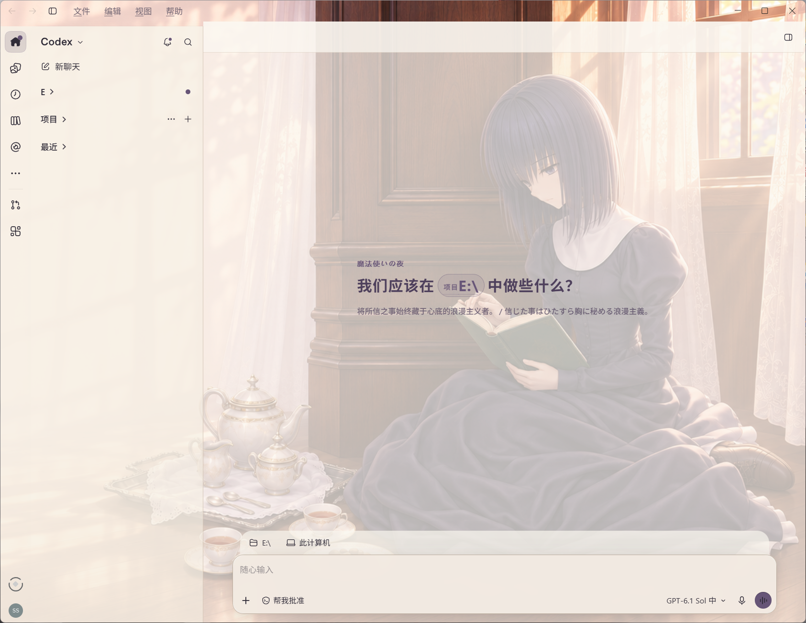

# Silkframe

用自己的图片装饰 Codex，重开后自动恢复。

Windows x64 · 预览版 · MIT · by螃蟹

[English](README.md) · [下载](https://github.com/7892samiuel/silkframe/releases)



## 使用

下载仓库后，在 PowerShell 中运行：

```powershell
powershell -NoProfile -ExecutionPolicy Bypass -File .\scripts\Install-Skill.ps1
```

在 Codex 中附上一张图片，然后输入：

```text
使用 $codex-image-skin，把这张图设为皮肤，保留原版入口，重开后自动恢复。
```

Skill 会保存图片、生成配色、检查本地环境，再应用主题。首次配置后，后台在本机自动恢复皮肤，不需要模型在线。首次安装时若 Codex 已经打开，可能需要正常退出并重开一次。

## 我们做了什么

- **原始激活进程内准备。** 在原版启动进程的已有参数空间中加入本地主题通道，保留默认登录资料和原始协议参数。
- **跨窗口交接的加载幕。** 加载画面有独立生命周期，覆盖应用内部的窗口替换；主题实际就绪后退场，支持跳过和超时退出。
- **本地持续恢复。** 设置由本机后台保存与应用，模型额度耗尽或聊天关闭后仍可工作。

给一张图后，skill 会生成背景配色、保存主题并提供暂停、恢复与停用操作。加载幕的图片、颜色、双语文案和署名均可配置。

[设计与实现](docs/DESIGN.md)

<details>
<summary>加载画面与演示</summary>


[查看约 9 秒的实际演示](docs/media/demo.mp4)

图片和视频是有珠主题示例。安装包不包含这张背景，默认使用你提供的图片。

</details>

## 支持范围

目前面向 Windows x64 的官方 Store/MSIX Codex、Owl 运行时。它通过本地后台和回环调试通道应用样式，是第三方方案；不修改官方安装文件。

本机效果已实测。公开版已迁移启动与加载逻辑，首次安装的独立干净环境验收仍待完成，适合愿意反馈问题的预览用户。后续 Codex 更新可能需要适配。

[安装与恢复](docs/SETUP.md) · [实现与配置](docs/RUNTIME.md) · [发布验证记录](docs/RELEASE.md)

## 致谢

样式注入基于 [Codex Dream Skin](https://github.com/Fei-Away/Codex-Dream-Skin) 1.5.21。第三方许可与本地修改见 [THIRD-PARTY-NOTICES](THIRD-PARTY-NOTICES.md)。

本项目代码采用 MIT 许可。截图中的角色与作品标识不属于代码许可范围。

觉得有用的话，欢迎点个 Star，或反馈你的 Codex 版本与使用效果。
