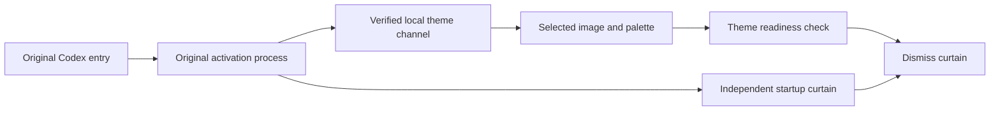

# Silkframe design

Silkframe focuses on the original app lifecycle, window handoffs and a reusable skill/runtime boundary. Dependency provenance and licensing are recorded in [third-party notices](../THIRD-PARTY-NOTICES.md).

## 1. Prepare the original activation

The package activation callback receives the original suspended process. It verifies the user, session, package, executable and initial thread. A bounded adapter inserts the loopback debugging port into the existing command-line allocation through an absolute alias to the same executable. Original protocol arguments are retained.

No second browser or separate login profile is launched. When the original allocation is too small or identity checks fail, the original activation is preserved. Argument fixtures cover both successful insertion and refusal without mutation.

## 2. Keep a curtain across the handoff

The app may replace an early native window with a later main window while refreshing its session. A loading layer inside the early page disappears with that page. Silkframe uses an independently owned native surface that follows the verified main window instead.

While Codex is foreground, the curtain can temporarily stay above the replacement window. Switching away releases that temporary topmost state. A readiness monitor checks the selected theme, installed styles and main-page structure before dismissal. Skip and timeout paths keep the interface reachable.

Drawing uses a reusable offscreen buffer and a small dirty region for the progress bar. The image is decoded into memory so an active curtain does not lock the theme file during replacement.

## 3. Separate the skill from persistence

The skill interprets the image and requests, generates a theme, invokes setup and reports verification. A local runtime owns cross-launch restoration.

The distribution exposes image, palette, text and author credit as configuration. No example character, artwork or personal app profile is required. Existing verified theme environments are reused; foreign startup callbacks are preserved.

## Validation scope

Component fixtures exercise original argument tails, capacity refusal, complete frame composition, the replacement-window stacking race, skip, timeout, theme readiness and file-unlocked image loading. Syntax, manifest hashes, theme payloads and archive boundaries are checked separately.

These checks are evidence about the components, not proof that every Codex version or fresh Windows installation works. The preview explicitly keeps clean-user installation as an outstanding acceptance step. The approach is not claimed to be a first-ever theming technique, and the upstream engine remains credited.
